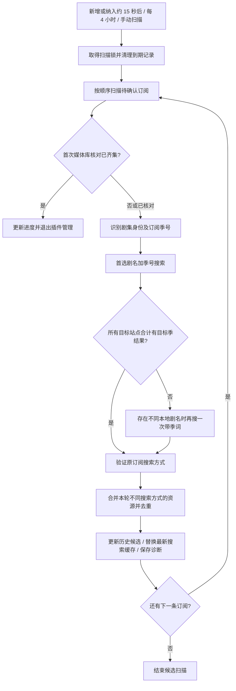

# 剧集守门员：设计与实现说明

[返回使用说明](../README.md)

这份文档记录候选搜索、规则确认和下载拦截的具体行为。日常操作步骤见 README。

## 代码与构建

- `package.v3.json` 是 V3 插件市场索引；插件源码在 `plugins.v3/subscribeoverwatcher/`。
- 配置页和详情页的 Vue 源码在 `frontend/subscribeoverwatcher/`，编译产物位于插件目录的 `dist/`。
- `tests/` 包含不连接真实数据库和站点的隔离行为测试。
- 修改 Vue 界面后，在前端目录执行 `npm ci`、`npm test`、`npm run build`，并提交更新后的 `dist/` 文件。

## 订阅接管与下载闸门

开启 **接管新增剧集订阅** 时，插件记录当前订阅 ID 水位；之后新增的电视剧订阅会进入待确认状态。启用前的订阅只在手动执行 **纳入所选剧集** 后进入管理。配置页在尚未启用插件时也会列出可纳入的历史剧集，并按订阅进度从少到多排序。插件记录历史订阅原来的暂停状态。

新增或手动纳入的普通剧集先由插件暂停，再在首次进度检查或候选扫描前核对一次媒体库。插件按订阅目标季、起始集和总集数读取宿主的媒体库缺集结果，写回 `total_episode` 和 `lack_episode`；媒体库已覆盖目标范围时还恢复插件造成的暂停，并让该范围退出插件管理。活动订阅会保留，插件不会调用订阅完成流程。用户原本暂停的历史订阅保持暂停。洗版订阅和待定 `P` 状态跳过此核对。核对结果和已尝试标记写入 `gate_state`，周期候选扫描、手动扫描及重启不会对同一管理周期反复查库；目标范围后来扩大时可重新接管并重新核对。识别或媒体库查询失败时保持待确认，继续收集候选。

待确认订阅默认暂停，下载提交前的事件处理器会拦截尚未批准的订阅下载。关闭 **全集种子也需确认** 后，插件原先暂停的待确认订阅会恢复并补搜；只有原订阅规则选中的资源，在事件中被明确识别为覆盖**当前目标季全部集数**，且本次所选文件属于该种子时，才会自动放行。即使本次只选择缺集，也按全集种子处理。分集仍被拦截；总集数未知时不会自动放行。跨季资源不参与自动整季放行。

直接批准只记录批准状态，保留原筛选规则，并安排缺集补搜。待确认的普通剧集在订阅进度显示已完成全部目标集后也会自动走这条路径：订阅缺失集数、总集数或状态变化后约 2 秒检查，整理完成事件也会检查，另每 15 分钟复核一次，候选扫描前也先检查。进度按有效总集数和 `lack_episode == 0` 判断，不查询媒体库；总集数无效或缺失集数未知时继续待确认。增强版待定 `P`、用户原本暂停的历史订阅、非插件造成的暂停以及显式撤销不会被自动恢复；洗版订阅仍按原确认流程处理。撤销批准会保留当前规则、暂停订阅、取消尚未启动的插件补搜任务，并恢复下载拦截；显式撤销优先于全集免确认设置。已提交的任务不会撤回。

数据页候选行的 **配置·站点名** 和 **下载·站点名** 都会选中对应站点的候选并进入配置页，不在数据页提交下载。配置页可选择 **预览匹配** 后 **确认并恢复**，也可核对标题、大小和站点详情，点击 **一次性下载整个种子** 后再点 **确认整包下载**。插件优先使用当前进程内存搜索结果中的原始下载链接；没有唯一匹配或缺少下载链接时，只重查所选站点，并要求候选 ID、站点、安全详情链接及媒体身份与原选择一致，再走 MoviePilot 单资源手动下载入口。重查结果只用于本次提交，不写入持久缓存。配置页可为这次任务另选下载根目录；留空目录时沿用订阅原目录或系统默认目录。一次性下载不应用规则草稿，不要求规则预览，也不批准或恢复订阅。无可核对详情链接、重查后仍缺少唯一对应资源或下载链接、订阅身份或范围变化时不提交，并提示手动扫描所选剧集。重启后只恢复脱敏的预览缓存，确认整包下载时需要从所选站点重新取得实时下载链接。MoviePilot 下载链遇到已失效的短时签名时可能刷新同站同资源的链接。提交时不传集数限制，跨季资源会下载全部文件；候选标题和集号并非种子文件内容的保证，用户须先在站点详情核对。最近一次成功提交展示在插件详情页，下载器是否完成仍以 MoviePilot 和下载器状态为准。

## 候选搜索与集数识别

### 扫描流程（1.9.22）

1. 自动周期每 4 小时扫描受管理的待确认电视剧；新增或手动纳入约 15 秒后只扫描对应 ID。重启只安排未扫描或上次扫描已满 4 小时的订阅。手动扫描只扫描所选订阅，不要求已有候选，也不重置全局 4 小时定时器，临近下一轮时可能很快再扫描。候选扫描互斥，订阅逐条执行；一次查询中，各站点按宿主线程数并行，同站点逐页执行。
2. 候选扫描使用系统搜索站点范围，不采用订阅的站点或筛选规则，显式跳过系统和订阅规则组。单站主动预览则把所选站点传给搜索链。媒体身份、年份与目标季仍需通过宿主及插件核对；“跳过规则组”不会跳过媒体识别。
3. 首选常见英文名加订阅季号；没有英文名则用本地名。只有这一阶段所有站点合计没有目标季资源，且存在不同本地名时，才尝试备用带季词。随后始终验证原订阅搜索，保留其自定义关键词、IMDb 开关及识别词。原搜索可能按宿主配置尝试多个别名，开启多名称搜索时继续，否则取得可用结果后停止。
4. 同一订阅本轮的带季、备用和原搜索共用局部失败状态及相同查询结果。真正失败或本轮暂缓的站点不再换词或翻页；正常空页不算失败，后续不同词仍可查询。相同站点、实际搜索词、资源类型与页号只实际请求一次。下一条订阅及下一次扫描重新独立尝试。
5. 默认同站插件请求开始时间相隔随机 10–20 秒，站点配置更长时取更长值，请求耗时计入间隔。同站插件在途请求不重叠。插件间隔及在途等待最多 60 秒；宿主真实访问额度的等待由宿主管理。原搜索换别名还可能沿用宿主的 1–10 秒随机等待。扫描、预览与系统搜索都受宿主站点的真实访问计数、配置间隔和明确远端限流约束；插件随机间隔只控制插件发起的请求，不给系统额外注入失败冷却。
6. 每个词从第 0 页开始，最多抓取宿主配置的搜索页数；前页达到站点单页容量时才继续下一页，空页或短页停止该词。没有持久分页游标、失败页自动续扫或到期重试任务。失败后等下次周期或手动操作，不频繁重试。
7. 本轮目标季资源进入最新搜索缓存，正常返回的零结果或部分结果也替换同范围旧缓存；候选列表则合并历史，最多 80 条。同站点同详情链接只保留一条；缺少详情链接时按站点、标题和大小去重，旧缓存里的重复项也会在预览时合并。缓存持久化且没有年龄淘汰，最多 256 组、64 MiB。扫描写入默认站点范围键，并记录当时实际覆盖的站点；预览按站点复用最近结果并重新按当前规则筛选，不能用累计候选代替搜索结果。
8. 候选扫描本身只收集和展示版本。确认后写回通过预览的规则；搜索词仅可选“沿用原订阅搜索方式”或“使用剧名＋季号搜索词”，后者如“Show S01”，须在本轮召回所选版本。默认沿用原订阅；原搜索正常完成却未召回所选版本、剧名加季号查询已召回时，预览自动将选择切为剧名＋季号搜索词。手动改选后须重新预览，预览仅计入该方式召回的资源；确认时才回填关键词，并按需切换至标题搜索。恢复的订阅约 2 秒后安排原生缺集补搜，后续下载由 MoviePilot 处理，用户原本暂停的历史订阅保持暂停。此次独立失败处理覆盖候选扫描、主动预览及回刷资源重查，不修改确认后的原生订阅调度。确认立即清理搜索缓存，候选及确认预览在批准满 24 小时后的下一次扫描清理。

这里的一轮指一次订阅搜索调用，包含其中所有关键词和页请求；不是一轮只请求一次。若原搜索实际尝试 `K` 个不同词、备用带季词使用了 `F` 次（0 或 1）、每词最多 `P` 页，则单站页请求上限为 `(1 + F + K) × P`，相同实际查询复用、提前停止和本轮失败都会降低次数。宿主资源源或单页内部的请求不计入这个页请求公式。关闭“全集种子也需确认”时，纳入后的全集补搜是另一次原生下载搜索，独立于上述候选扫描。

插件复用 MoviePilot 的媒体识别和 `SearchChain.process`，没有另建站点搜索实现。扫描显式传入空规则组，不使用当前订阅的站点和筛选规则；单站预览仍限定该站。使用常见英文名或本地剧名加 `S07` 的明确关键词，未命中时最多尝试一个本地名称，再验证一次原订阅搜索。原搜索保留订阅 `keyword`、IMDb ID 搜索及识别词设置；没有显式关键词时沿用宿主别名策略，兼顾跨季包与不使用 S 编号的本地标题。媒体对象不绑定单季，也不传入单季缺集限制，以便保留包含目标季的跨季资源；收到结果后再核对媒体身份和季列表。不同查询词命中的相同资源在当前操作内合并；预览也可按站点组合不同轮次的缓存，保留各站的搜索词验证记录。

关键词的季号取自订阅：第 1 季为 `S01`，第 7 季为 `S07`，缺少季号时沿用第 1 季。带季查询中，宿主给英文站点改用英文名时，插件在站点请求前补回本轮季号；原订阅搜索不额外添加季号，未指定关键词时用宿主剧名及别名策略补收合集。预览只临时使用这些查询词，不修改真实订阅。

搜索缓存记录带季查询的命中词，以及原订阅搜索召回的资源。默认沿用原订阅；只有原搜索在对应站点正常完成、未召回要验证的资源，而带季查询能召回时，预览才自动切换选择，并在确认时回填订阅 `keyword`，按需关闭原来的 IMDb ID 搜索。候选原站点在当前范围内时验证所选版本；自选范围排除候选原站点时，验证所选站点中符合规则的资源。选择“使用剧名＋季号搜索词”时，插件要求该词在当前范围的搜索结果中召回上述资源，并按该词过滤预览；沿用原方式时，仅把原搜索召回的资源计为匹配。原搜索失败或缓存未验证当前原设置时不自动调整关键词，并提示重新搜索或手动选择剧名＋季号搜索词；修改搜索词选择会使旧预览失效。预览自动改动的搜索词框和规则组框会显示警示色边框和文字提示。直接批准保留原设置。资源与查询词的完整映射随持久搜索缓存保存，候选和预览展示记录只保留最终选择与诊断摘要。

新订阅和手动纳入的订阅在 15 秒内合并扫描对应 ID；其他待确认订阅不会被重复扫描。保存设置、预览或刷新页面不安排额外全量扫描。启动时只补收未扫描或距离上次扫描已满 4 小时的订阅；此后目标季候选每 4 小时更新。这个周期只约束自动扫描，不给预览缓存增加超龄限制。候选按以下顺序排列：

1. **识别集数覆盖全集**：解析出的集号覆盖订阅记录中的目标季总集数。
2. **跨季资源（含目标季）**：识别季列表包含目标季，但各季集数待核实。
3. **疑似整季（集数待核实）**：主标题、副标题或站点标签含“全集”“全季”“完结”“Complete”“Season Pack”“全5集”“5集全”等线索，但不能明确证实覆盖全集。“全五集”等中文数字和全角数字也支持；“未完结”“非全集”“Not Complete”等否定说明不作为合集线索。
4. **含首集的多集资源**：明确识别的目标季集号包含 E01 和至少另一集，例如副标题“第1-3集”解析为 E01–E03；只显示已识别的覆盖范围，不视为全集。
5. **单集 E01**：明确识别为目标季首集。

标题或解析结果已明确指出资源只从后续集数开始时，不会把它当成首集、含首集多集资源或疑似整季；例如 `S01E11`、E11/12。升级时也会清理旧状态中的同类误判。

目标总集数来自订阅记录，资源集号来自宿主的资源解析，均不是种子文件内容的核验结果。“未识别具体集号”表示解析没有提供集号；即使副标题“全5集”被宿主解析为总集数，也不会据此生成 E01–E05。站点“完结”标签同样只作为疑似整季线索，不改变全集免确认的下载校验。MoviePilot 的跨季集号列表没有按季拆开，因此跨季资源不会被标成目标季全集，也不能用于手动指定集数回刷。

系统媒体详情的标题搜索可展示全部媒体匹配资源；插件扫描还筛选目标季及上述候选类型，因此这次补上副标题和标签线索后，仍不保证扫描列表与系统搜索逐条一致。规则预览使用最新搜索结果，并继续按所选站点、搜索方式和生效规则筛选。

## 历史候选、大小和跨站合并

配置页提供单条待确认剧集的手动扫描，选项不要求已有候选。手动扫描获取扫描锁后只调用该 ID 的候选收集，移除同 ID 尚未执行的首次扫描队列，避免紧接着重复搜索；不会调用批准后的下载补搜。完成后更新完整缓存、候选列表及诊断，并清除旧规则预览。与其它候选扫描并发时提示正在进行，不额外启动。

选中候选后，配置页的 **候选规则确认** 标题旁也可直接 **重新扫描此剧集**，自动选中当前订阅并清除先前的一次性下载确认。扫描结果会在候选区域反馈；若所选版本没有出现在本轮结果中，会明确提示它只是保留的历史候选。数据页的站点详情链接是经过清理的页面地址，不是种子下载链接。内存结果被后续扫描替换、插件重启或重载后，历史候选仍可见；确认整包下载会只重查所选站点并核对同一资源，若未找到则拒绝提交。手动扫描可更新候选列表，之后仍需再次核对站点详情并确认下载。

实际站点页请求不再配置 `SubscriptionSiteBudget`，因此不读取或增加系统订阅的跨订阅失败退避。底层仍调用宿主站点搜索入口，保留站点访问计数、`limit_seconds`、`limit_interval`、`limit_count` 和宿主识别出的远端明确限流。插件用进程内请求间隔控制同站请求的开始时间，默认随机 10–20 秒，站点配置更长时取较大值；同站插件在途请求不重叠。停止插件可取消插件间隔等待，这部分等待超过 60 秒或预计间隔超过剩余等待时间时，本条订阅本轮暂缓该站，其他订阅独立评估，不保存失败冷却；宿主真实额度等待仍由宿主管理。正常间隔记录不随配置保存或新建插件实例清空，但不写入磁盘。

MoviePilot 搜索链的结果去重键包含站点名、标题和描述；不同站点的结果仍各自保留。插件再用 `站点 ID | 标题 | 字节大小` 的摘要合并历次扫描中的同一候选，更新“最后发现”并保留“首次发现”。单条订阅最多保留最近发现的 80 个候选，包括当次搜索中已经消失的版本。标题或大小变化可能形成新候选；这不是种子文件哈希去重。

本轮多个搜索词返回同站点同详情链接时，插件保留一条记录，并合并去重后的副标题片段和标签；缺少详情链接时按同站点、规范化标题和大小识别重复。合并使用副本，不修改宿主返回的原对象，也不拼接不同解析的季号或集号。主标题及季集解析沿用主记录；预览旧缓存时优先沿用用户所选版本，并合并不同记录的搜索词命中证据。旧持久缓存中的重复记录同样在预览时补充信息。回刷提交前重新搜索并保留原始不同记录，核对资源唯一性；候选整包下载优先使用已扫描的内存结果，缺少实时下载链接时只重查所选站点。

详情页和规则预览只在**不同站点**的记录同时满足以下条件时，才把它们合并显示为一行：规范化标题、精确字节大小、候选类型、集号、目标总集数、跨季季数和解析规格一致；规则预览的排除原因也需一致。同站点的不同候选保持独立。大小未知的记录不会跨站合并。合并仅影响展示和同版本全集计数，原候选、站点选择及详情链接仍独立。

大小以 KiB、MiB、GiB 等二进制单位展示。选择项和详情表格同时列出精确字节数，以区分显示值四舍五入后相同的候选。站点详情链接只放在对应的站点名称上，资源标题为普通文本；没有安全详情地址时，站点名称也显示为普通文本。旧候选要再次被扫描发现后，才可能补上详情链接。

候选表格、版本选择项和规则预览同时显示做种人数及免费/促销；选定版本后，配置面板也单独显示该站点的信息。跨站合并的行按站点分别列出人数和促销，不累加人数或共用免费状态。下载倍率为 0 显示“免费”，折扣显示下载计费百分比，非普通上传倍率同时显示，例如“免费 · 上传 2×”。未知人数、促销和缺少新字段的旧候选显示“未知”，0 人仍明确显示为 0 人。数据是最近搜索时的快照，持久缓存可恢复；重新搜索可刷新，候选记录在再次扫描发现资源时更新。

## 规则预览、回填与确认

配置页先选择剧集，再选择该剧集的候选版本；剧集列表只包含待确认且已有候选版本的订阅。切换剧集会清除之前选择的版本和规则草稿。
切换剧集也会清除下载目录选择，避免把上一部剧的硬盘选择带到另一部剧。
详情页每个候选行按站点提供配置按钮；点击后切到配置页，自动选中该站点的版本，把候选识别出的有效规则填入草稿以便修改。配置页手动选择版本也会填入草稿。跨站合并展示的候选仍逐站点选择。若版本在切换页面前失效，配置页会提示重新选择。

选择候选是选择**规则模板**，不是锁定或立即下载该种子。默认回填候选站点；**自选站点**可输入名称，按名称包含关系筛选当前启用的索引站点并多选，至少选一个，也可排除候选原站点；**不限站点**清除站点限制。切换范围保留其他规则选项。排除候选原站点时，确认要求所选站点范围内至少有一条符合规则和搜索词的资源。

**下载目录**从宿主目录卡片中读取支持电视剧的资源根目录，选项显示名称和完整资源 URI，同一根目录只列一次。选择后须与候选规格一起预览确认，确认只回填根目录。留空保留订阅原保存目录；原目录也为空时，预览按宿主规则选择默认目录，不把默认选择写回订阅。

预览沿用宿主的保存路径校验、精确根目录匹配和 `build_media_download_path` 分类计算规则，显示所选候选及每条通过资源的完整预计路径。自定义子目录保持原路径。同根目录存在多张卡片时，分类配置遵循宿主的媒体条件及优先级匹配；插件不另行绑定卡片或改写下载事件。无法计算路径时显示原因，版本规则的匹配结果保持不变。

确认后修改分类开关，后续下载采用宿主当前配置；修改根目录或删除卡片，不会同步改写订阅已经保存的路径。旧路径仍在其他配置根目录范围内时可继续使用，否则宿主会因路径不在允许范围内而拒绝下载。插件不额外要求撤销或重新批准。整理也由宿主根据资源路径和媒体条件匹配媒体库。

规则面板用下拉框展示**质量、分辨率和特效**，常用选项及对应正则与 [MoviePilot V3 订阅卡片](https://github.com/jxxghp/MoviePilot-Frontend/blob/v3/src/api/constants.ts)一致。常见质量默认采用能匹配所选资源标题的内置选项；标题使用特殊分隔符等内置规则无法匹配时，继续使用该候选的匹配方式并显示名称。**包含、排除**支持选择候选标识或直接输入关键字/正则。制作组与自定义标识都能在标题中验证且不相同时，会组合为包含规则，并以名称展示；也可选择 **只用制作组**，或输入 `TEAM|GROUP` 等自定义包含正则。制作组字面值会转义，名称中的点不会被误当成正则通配符。

面板不展示规则 JSON。选择候选匹配方式保留原有正则，选择订阅卡片的常用选项则采用对应标准规则。未识别的候选属性默认保留订阅原值；显式选择**保留原订阅**不回填该项。选择**全部**或清空包含/排除会清除订阅对应字段，宿主有默认条件时仍可能使用默认条件，以预览展示的实际生效条件为准。旧版本保存的规则草稿仍兼容，常见候选质量的名称引用解析成内置规则；明确保存的自定义正则继续保留原文和匹配方式。可回填的字段包括质量、分辨率、特效、包含、排除、站点和下述规则组选项。

**规则组**可选择 **保留原订阅 / 默认规则组**，或 **清空并不使用规则组（确认后生效）**。MoviePilot 在订阅的规则组列表为空时会回退到普通订阅或洗版默认规则组，单纯写入空列表无法关闭默认组。插件仅在用户确认此选项时创建或复用 **剧集守门员·不使用规则组**，其规则为内置 `WEBDL | !WEBDL` 全放行表达式，再将它显式指定给该订阅。这个选择适用于确认后的补搜和宿主正式追更；基础质量、站点及宿主默认大小等条件仍照常筛选。预览阶段只显示选择与生效阶段，确认前不注册或回填规则组。同名组若已被修改或配置保存失败，确认会失败并保持待确认状态。

**只用所选站点**及 **自选站点**时，下方规则区的 **站点** 栏同步显示站点名称及编号；预览将站点列表传入宿主搜索链，只查询所选站点。复用默认范围扫描时，也先筛出所选站点资源，因此其他站点不会计入排除统计。**不限站点**时，站点栏同步显示不限站点，实际范围与 MoviePilot 当前默认搜索站点一致：系统 `IndexerSites` 有配置时取该配置中仍可用的站点，否则取当前可用站点目录。确认页可合并覆盖这些站点的缓存，只补搜缺失站点。

每 4 小时执行的候选扫描始终重新搜索，并把本轮结果交给默认范围预览缓存。**预览匹配**为每个目标站点选最近的缓存；若只缺部分站点，只向这些站点发起查询，再合并资源、失败诊断及搜索词证据。空结果也代表该站点已经搜索。每次预览重新读取生效条件并重新筛选、计算下载目录；历史候选列表不充当搜索结果。预览显示复用和实际搜索的站点、最旧结果的年龄及最新搜索时间；不同站点的资源可能来自不同轮次。

**预览有对应站点的缓存就复用，不设超龄限制，也没有复用时长设置**；缺少站点缓存或点击 **重新搜索并预览**时才查询站点。缓存以订阅媒体身份、目标季、集数组身份、活动身份和站点范围区分，最多保留 256 组、磁盘合计 64 MiB；一组是一个身份与一个站点范围的搜索结果，大小不固定。每组一个 JSON 文件，保存在插件数据目录的 `search-cache` 子目录，同一范围原子替换。容量满时淘汰较旧文件并同步移除内存结果，日志记录组数或容量淘汰、批准、停用、删除订阅、损坏文件和主动刷新失败的清理原因。恢复后根据各站点的持久时间计算缓存年龄。文件保留预览候选事实、离散季集、媒体分类、站点过滤字段、实际覆盖站点及原搜索/带季命中映射，不保存 Cookie、下载地址和下载配方；包含下载上下文字段的旧缓存会被删除。当前进程的完整搜索结果留在内存中供整包下载；重启后只有脱敏结果可供预览，整包下载需按所选站点重查链接。规则和目录仍在每次预览重新核对。旧版默认范围文件若缺少实际覆盖站点信息，会清理并重新搜索，避免将后来新增的站点误认为已覆盖。磁盘写入失败时当前进程仍可使用新结果，日志说明无法持久保存。

定期候选扫描仍重新搜索并更新缓存。批准成功后主动释放该剧集的内存和磁盘搜索缓存；候选和确认预览保留 24 小时，满 24 小时后由下一次扫描清理，批准状态与订阅规则继续有效。后续回刷预览从自身生成时间起保留 24 小时，再由扫描清理。订阅删除或身份变化后，启动或下次扫描清理无对应订阅的缓存；显式停用插件也清除缓存。停止服务、重载和更新只释放内存，下一次启用初始化恢复磁盘记录。单站或多站子集主动搜索成功后保留已有的默认范围缓存；其结果可与其他站点缓存组合供不限站点预览。主动搜索失败时移除受影响站点的旧缓存，防止把旧结果误认成本轮结果。手动回刷提交始终重新搜索核对资源，不复用预览缓存。

配置面板开始预览时先快速检查本次站点范围的缓存，等待过程中列出可复用及缺失的站点名称和编号；部分缺失时提示只补搜这些站点。手动刷新显示“已手动触发重新搜索”。数据页点击 **配置·站点** 或 **下载·站点** 都只传候选 ID，跳转本身不会删除或刷新搜索缓存；已有默认范围缓存会直接复用。历史候选独立保存，不能代替已清理的搜索缓存。空缓存仍会复用，并在结果旁提示缓存中没有资源、建议手动搜索，提供 **重新搜索并预览** 或 **重新搜索回刷资源** 按钮。空缓存按本次站点范围的原始搜索资源数判断，搜到资源但全部被规则排除时不会误报为空。

配置面板直接显示预览结果，并自动滚动到结果卡片；数据页不展示规则或回刷预览快照。面板列出原订阅、宿主默认和候选/草稿的实际生效条件，并显示媒体识别、站点搜索与资源解析、规则筛选、目录计算的耗时，及包含设置保存和列表刷新的整体操作耗时。日志同步记录四个阶段；宿主搜索日志中的站点耗时可进一步定位慢站点。

结果旁可展开实际搜索词、每轮媒体匹配数量、目标季保留数量及耗时。详情页同时显示本轮发现候选数，区分最新扫描与累计历史候选。宿主的上游媒体识别排除仍不计入插件规则排除数；目标季结果为零时说明可能未命中或已被上游过滤。

失败状态仅保存在当前订阅这一次搜索调用中；带季、备用带季和原搜索验证共享这份本轮状态。一站真实失败或被宿主额度限制后，本条订阅本轮不再向它换词、重试或翻页；不同订阅、下一次扫描和主动重新搜索各自尝试。相同站点、最终实际关键词、类型和页号的成功结果在本轮复用，减少别名和英文站点名称转换造成的重复请求。失败记录按站点去重，诊断同时给出真实请求次数与同轮复用次数，不为普通错误编造最早重试时间。升级时移除旧的插件共享失败冷却；宿主站点自身的访问额度及明确限流仍保留。

通过与排除资源优先显示全集。每条排除资源显示宿主返回的**首个未满足条件**，例如站点范围、缺少包含标识、命中排除规则、质量、分辨率或特效；其他未覆盖的原订阅条件和宿主默认条件也可能导致排除。面板按原因汇总全部排除资源。配置页最多展示前 80 条通过和前 40 条排除资源，摘要保留完整计数。更改草稿、站点范围或目录后，旧结果标记为需重新预览。

自动候选扫描显式传入空搜索规则组，跳过全局及订阅规则组；预览先核对基础条件，再调用宿主规则组过滤器进行对比。订阅明确指定的规则组优先，否则使用普通订阅或洗版默认组；考虑规则组全部排除、跳过规则组仍有匹配资源时自动选择不使用规则组。预览不模拟最终下载排序、种子文件内容或未来资源，不修改真实订阅、不提交下载。

**确认并恢复**要求预览生成于 30 分钟内、订阅身份和规则范围没有变化，并且所选候选仍通过当前规则。选择全集候选时，如规则同时匹配多个不同的全集版本，须收窄规则并重新预览。确认后插件回填规则、恢复原本不是由用户暂停的订阅，并安排一次缺集补搜。原本由用户暂停的历史订阅保持暂停；后续由 MoviePilot 按选择的规则组策略正常追更。手动修改已批准订阅的规则不会撤销批准，但会使旧预览失效；实际下载提交前仍会核对当前质量、站点等基础规则。

## 手动回刷已入库集数

已批准订阅可以先按当前规则预览可回刷资源，再选择一条通过的资源和明确的集数，例如 `1,3-5`。提交时插件重新搜索同一资源，核对订阅身份、当前规则、资源唯一性和识别集数，然后调用 MoviePilot 的单资源下载接口。预览超过 30 分钟、资源消失或规则变化时需重做预览。

集数由用户明确指定；插件不判断该集是否已入库，也不删除旧文件。下载器接受任务不等于媒体库已完成替换，最终整理与文件覆盖由 MoviePilot 决定。相同种子已经在下载器中时，下载器可能拒绝重复任务。

## 状态、通知与边界

配置页列出已纳入管理的剧集和确认状态；详情页还显示接管来源与订阅进度。普通订阅进度按 MoviePilot 的总集数减缺失集数计算，洗版订阅显示洗版完成进度；字段不足时显示“订阅进度未知”。进度值可能早于整理入库更新，也不等于下载器任务或文件数量。

首次接管时的媒体库核对只刷新集数进度，已齐集则退出插件管理，不触发完成流程；之后的自动批准仍只看订阅进度，不重复查询媒体库。一次性整包下载提交后仍保持待确认；手动下载通常到整理入库后才更新订阅进度。订阅自身发起的下载可能在下载器接受任务时就将进度写满，因此自动批准可能早于入库。自动批准会安排一次 MoviePilot 缺集与完成对账，订阅是否最终完成仍由 MoviePilot 及已安装的完结守卫决定。MoviePilot 判定订阅完成后会将其移入订阅历史并从当前订阅表删除；插件在下一次候选扫描时清理失去对应订阅的管理记录和搜索缓存。

插件默认每天在 MoviePilot 所在时区的 09:00 以**插件**消息类型发送一条待确认订阅汇总，包含总数、订阅 ID、剧名和季数；没有待确认订阅时也会发送 0 条汇总。时间和开关可在配置页修改。

长期设置用 **保存设置** 保存；各分区操作按钮会同时保存当前设置并执行一次性操作。配置页在操作后刷新选择项并显示本次结果；详情页只显示当前管理状态。插件通过 `gate_state` 保存与仍存在的订阅对应的待确认、已批准、候选和回刷记录；正常升级不会因版本号变化清空它们。卸载时若同时清除插件数据，则无法恢复。每条订阅最多保存 80 个候选，规则预览和回刷预览各只保留最新一次，每份最多保存 80 条通过、40 条排除资源，新预览覆盖旧预览。确认满 24 小时后，下一次扫描删除候选和确认预览；新的回刷预览单独按生成时间计 24 小时，待确认订阅的记录继续限量保留。手动回刷仅记录最近 20 次已接受下载任务的标题、集数与提交时间。订阅删除后，下次扫描删除对应记录；记录数量随受管理的订阅数量变化，不会随扫描或预览次数无限累积。

候选与预览仅保存种子标题、站点编号、规格、大小、识别集数、发现时间和清理后的站点详情地址，不保存种子下载链接或站点 Cookie。下载闸门依赖插件已安装、启用并成功注册事件处理器；停用、卸载、重载空窗或后续处理器覆盖取消标记时，纯插件无法保证绝对拦截。撤销时已越过下载前事件的在途任务也无法回滚。没有订阅来源的手工下载不在拦截范围；停用期间创建的订阅不会在重新启用时自动纳入，但可以手动纳入。

本仓库只提供插件源码与前端编译产物，不修改 MoviePilot 主程序，也不会自动安装、启用或重载运行中的实例。
